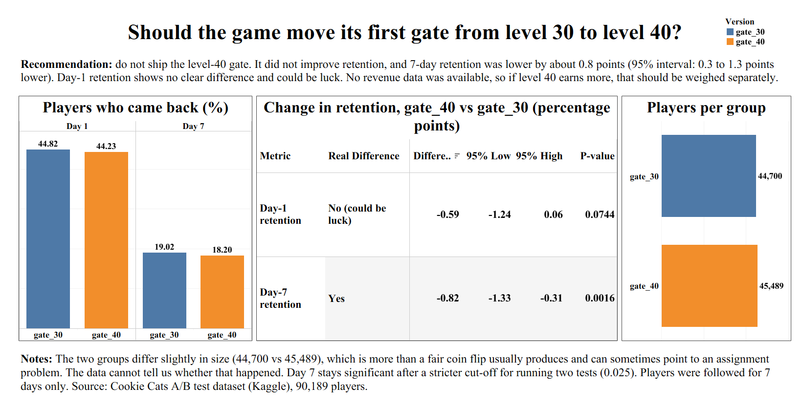

# Should the Game Move Its First Gate from Level 30 to Level 40?

An A/B test analysis of about 90,000 players of the mobile puzzle game Cookie Cats, built with **Python** and a **Tableau Public** dashboard.

**Business question:** A game tested moving its first gate (a forced pause) from level 30 to level 40. Did the change affect player retention, and should it ship?

## Recommendation

**Do not ship the level-40 gate.** It did not improve retention, and 7-day retention was slightly *lower*. This data has no revenue information, so if level 40 brings in more money, that would need to be weighed separately.

## Results

| | gate_30 (control) | gate_40 (change) | Difference | 95% interval | Real difference? |
|---|---|---|---|---|---|
| Day-1 retention | 44.82% | 44.23% | -0.59 points | -1.24 to +0.06 | No, could be luck (p = 0.074) |
| Day-7 retention | 19.02% | 18.20% | -0.82 points | -1.33 to -0.31 | Yes (p = 0.0016) |

- The day-7 drop is about 4.3% in relative terms.
- It stays significant after a stricter cut-off for running two tests (0.025).
- A bootstrap check (10,000 resamples) gave the same intervals.
- Game rounds were about the same in both groups (median 17 vs 16).

## Dashboard

[Open the Tableau Public dashboard](https://public.tableau.com/app/profile/nirmala.kanchumarthi/viz/CookieCatsABTest_17954236565870/Dashboard)



## Method

1. **Checked the data:** 90,189 players, no duplicate players, no missing values.
2. **Checked the split:** 44,700 vs 45,489 players. A chi-square test gave p = 0.0086, so the groups are slightly more unequal than a fair coin flip usually produces (see limitations).
3. **Handled an outlier:** one player had 49,854 game rounds (the next highest is 2,961), so I excluded that player from the game-rounds comparison only. Retention results are not affected.
4. **Tested retention:** two-proportion z-test, 95% confidence interval for the difference, and a bootstrap as a second check.
5. **Checked sensitivity:** with this sample, the smallest difference that could be reliably detected is about 0.9 points for day 1 and 0.7 points for day 7.
6. **Corrected for two tests:** Bonferroni cut-off of 0.025.

## Limitations

- **Small effect:** the day-7 drop is under one percentage point. It is real but may not matter much to the business.
- **Slightly unequal groups:** this can sometimes point to a problem in how players were assigned. The data cannot tell us whether that happened here, so I treat it as a caveat and not a conclusion.
- **Retention only:** there is no revenue, purchase or ad data, so I cannot say whether the gate position affects income.
- **Short window:** players were followed for 7 days only.
- **Aggregated flags:** retention is a yes/no flag per player, so I cannot see how retention changed day by day.

## Reproduce it

```
pip install pandas
# download cookie_cats.csv from Kaggle (search "Cookie Cats") into this folder

python 01_load_and_check.py
python 02_test_retention.py
python 03_export_results.py
```

## Repository structure

```
01_load_and_check.py     data quality checks and group sizes
02_test_retention.py     statistical tests, intervals, bootstrap
03_export_results.py     small CSVs used by the dashboard
results_summary.csv      players and retention per version
results_difference.csv   difference, interval and p-value per metric
dashboard/               dashboard screenshot
```

The raw dataset is not included. Download it from Kaggle.

## Data source

Cookie Cats mobile game A/B test dataset on Kaggle (90,189 players).
